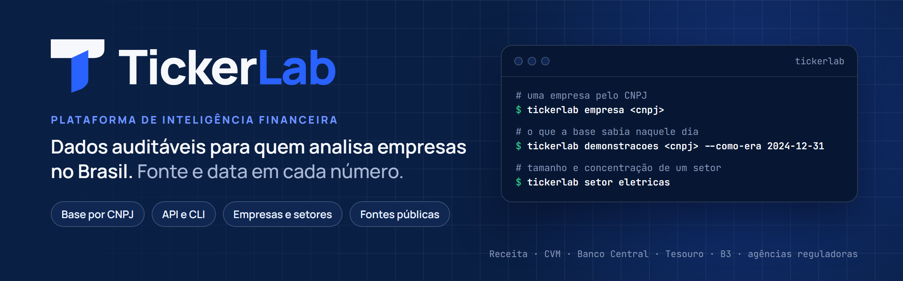
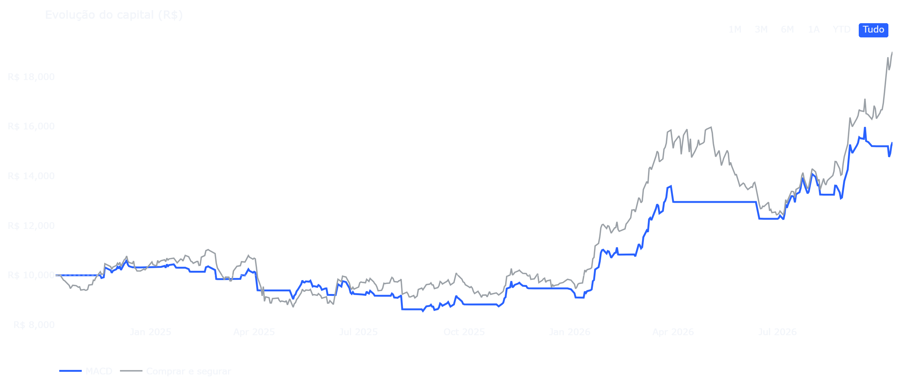
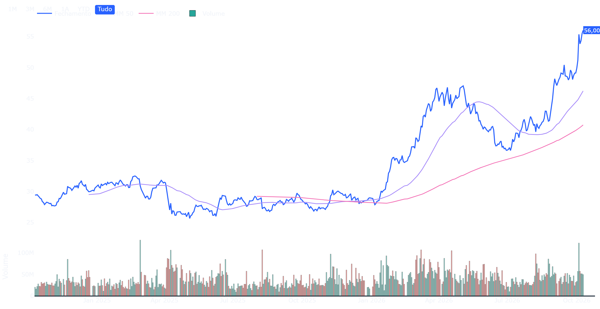
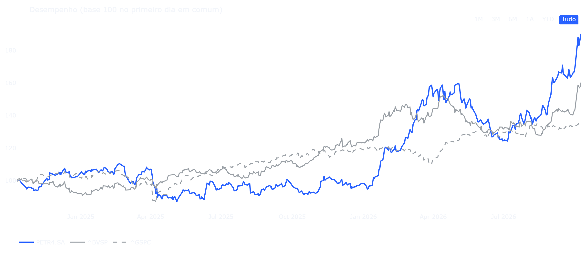
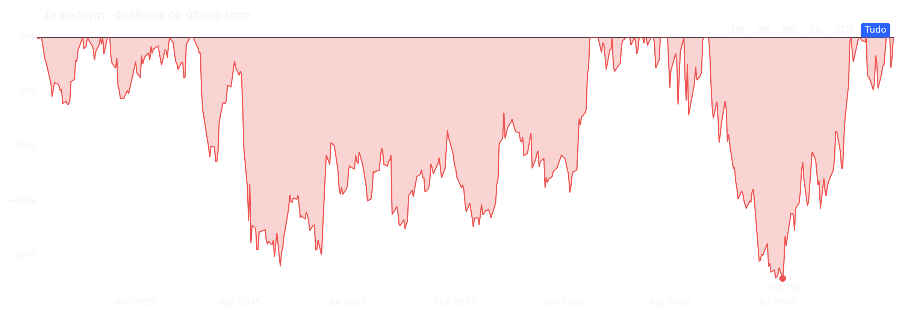
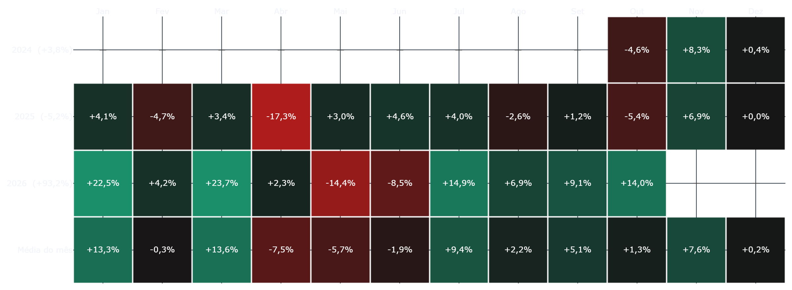

<p align="center">
  
</p>

<p align="center">
  <a href="https://github.com/tbc174/tickerlab/actions/workflows/testes.yml"></a>
  
  
  
  
  
  
  
</p>

<p align="center">
  <a href="https://tickerlab.com.br"><b>Site</b></a> ·
  <a href="https://app.tickerlab.com.br"><b>App</b></a> ·
  <a href="https://api.tickerlab.com.br"><b>API (TickerLab Data)</b></a> ·
  <a href="https://tickerlab.com.br/dados.html"><b>Fontes da base</b></a> ·
  <a href="https://tickerlab.com.br/ferramentas.html"><b>Ferramentas grátis</b></a> ·
  <a href="https://tickerlab.com.br/novidades.html"><b>Novidades</b></a>
</p>

# TickerLab

**Dados auditáveis para quem analisa empresas no Brasil.** O TickerLab é uma plataforma de
inteligência financeira, em fase de testes: junta as fontes públicas brasileiras (Receita, CVM, Banco
Central, Tesouro, B3, agências reguladoras e outros órgãos) numa base própria, ligada pelo **CNPJ**,
e entrega cada número com a **fonte**, a **data em que ficou público** e o caminho até o arquivo
original.

## Em um minuto

| Parte | O que é | Para quem |
|---|---|---|
| **Base de dados por CNPJ** | os arquivos oficiais guardados com o hash de cada um, em tabelas "como eram na data": uma consulta a um dia nunca enxerga o que só foi publicado depois | a origem de tudo o que vem abaixo |
| **API e CLI de dados** (TickerLab Data) | a mesma base por HTTP (`/data/v1`) e no terminal (`tickerlab empresa <cnpj>`), para sistemas e agentes de IA: perfil, demonstrações, setor, fundos e busca de empresas (e, só pela API, os comparáveis) | quem integra dados ou faz prospecção e análise por CNPJ |
| **App de análise e backtest** | relatório da empresa e do setor, Research com os fatos da CVM e da SEC, carteira, relatórios em PDF e teste de estratégias com dados do passado | quem analisa empresas e ativos |
| **Site público** | o produto, as fontes da base uma a uma, 14 ferramentas grátis, o pregão do dia e os estudos abertos | qualquer pessoa, sem login |

Três regras atravessam tudo: **origem de cada número** (fonte, data e documento), **sem olhar o
futuro** (cada dado vale só a partir do dia em que ficou público) e **honestidade com os números** (o
produto mostra também o que não funciona).

> [!IMPORTANT]
> Nada aqui é recomendação de investimento. Os dados vêm de fontes públicas e os preços, do Yahoo
> Finance; todos podem ter atraso ou erros. Rentabilidade passada não garante resultado futuro.

## Um exemplo: uma empresa pelo CNPJ, no terminal

```powershell
pipx install "https://github.com/tbc174/tickerlab/archive/refs/heads/main.zip#subdirectory=cli"
tickerlab login                                    # pede a chave da organização, sem mostrá-la
tickerlab empresa <cnpj>                           # perfil: cadastro na Receita e as entregas à CVM
tickerlab empresa <cnpj> --como-era 2024-12-31     # o que a base sabia naquele dia
tickerlab demonstracoes <cnpj>                     # demonstrações financeiras
tickerlab setor eletricas                          # tamanho, concentração e companhias do setor
tickerlab fundo <cnpj>                             # taxas, carteira e custo da taxa de um fundo
```

Cada resposta sai numa tabela, para a pessoa, ou no envelope JSON inteiro, para o agente de IA
(Claude Code, Codex e outros), sempre com a fonte e a data de cada campo. A API externa está em
**beta fechado, por chave e sem cobrança**, e ainda **desligada em produção** (ver o estado abaixo).
Guia completo: [`docs/cli.md`](docs/cli.md) e [`docs/api/README.md`](docs/api/README.md).

## O que está no ar hoje (10/11/2026)

| Parte | Estado |
|---|---|
| Site público (`tickerlab.com.br`) | no ar: produto, página Dados com as fontes, 14 ferramentas grátis, pregão do dia, estudos e novidades |
| App (`app.tickerlab.com.br`) | no ar, em fase de testes, com beta por convite: as telas novas em React na raiz e as demais na versão clássica (Streamlit), em `/classico/` |
| Site e documentação da API (`api.tickerlab.com.br`) | no ar: a página da TickerLab Data e a documentação das rotas |
| API externa de dados (`/data/v1`) | pronta no código e **desligada em produção**; liga com `TICKERLAB_API_EXTERNA=1` |
| API de leitura do app (`/api/v1`) | no ar: serve as telas novas do app, com login e sem preço bruto |
| CLI `tickerlab` | instalável a partir deste repositório; ainda não publicada em índice de pacotes |
| Cobrança | Stripe **só em modo de teste**: nenhum pagamento real é feito |
| Base de dados | em construção contínua, com coletas diárias e âncora no Bitcoin toda noite |
| TickerLab Trade (pesquisa de trading) | nenhum modelo aprovado até aqui; não há operação com dinheiro real |

## Em números

Contados no repositório em 10/11/2026.

| 159 tabelas | 133 fontes públicas | 584 arquivos oficiais | 46 páginas no app | 14 ferramentas grátis |
|:---:|:---:|:---:|:---:|:---:|
| no catálogo da base, com contrato versionado | na página Dados do site, 46 já em uso numa tela, relatório ou API | acompanhados pelo arquivista | no mapa de `src/paginas.py` | calculadoras e simuladores no site |

| 12 estratégias | ~1.700 ativos | mais de 800 arquivos de teste | 45 migrações | mais de 940 pull requests mesclados |
|:---:|:---:|:---:|:---:|:---:|
| tendência e reversão, com custos e stops | na busca: B3, S&P 500, índices, cripto e câmbio | mais de 11 mil funções de teste (mais de 14 mil casos, contados em 05/11/2026) | do banco, de 0001 a 0047 (Alembic) | desde 11/10/2026; hoje nada entra sem CI verde |

## A base de dados

O pacote `base/` roda fora do app e monta a base que alimenta todo o resto. A ideia central:
**várias fontes oficiais só mostram o "agora" ou reescrevem o passado sem avisar**, então a base guarda
cada original e responde como os dados **eram** em qualquer data.

- **Um CNPJ, muitas fontes:** cadastro e quadro de sócios pessoa jurídica (Receita), demonstrações e
  eventos (CVM), sanções (CGU), dívida ativa (PGFN), embargos (IBAMA), licenças e registros de
  agências reguladoras (ANEEL, ANP, ANS, SUSEP, ANM e outras), financiamentos e incentivos, fundos e
  o grupo econômico. A lista completa, com a licença e a data de cada fonte, está em
  [tickerlab.com.br/dados.html](https://tickerlab.com.br/dados.html).
- **Original guardado:** cada arquivo baixado fica no acervo com o SHA-256 como nome, e cada coleta
  entra num registro e num manifesto diário.
- **Ponto no tempo:** cada linha tem a data em que ficou pública e até quando valeu;
  `como_era_em(base, data)` devolve a base como era naquele dia.
- **Linhagem:** cada linha de cada tabela se liga ao manifesto, à coleta e ao original no acervo.
- **Contrato de dados:** as tabelas têm catálogo (`base/contratos/catalogo.json`), contrato congelado
  por versão e changelog (`docs/CHANGELOG-da-base.md`), com versão semântica conferida no CI. O
  dicionário de cada coluna está em `docs/dicionario-da-base.md`.
- **Âncora no Bitcoin:** toda noite, se a base mudou, uma raiz de Merkle dos manifestos é carimbada
  pelo OpenTimestamps. O recibo prova que aquela versão já existia naquele bloco; não prova que o
  dado está certo (`docs/ancoragem-da-base.md`).
- **Qualidade sem maquiagem:** as regras apontam problemas e nunca corrigem em silêncio; empresas
  que saíram da bolsa continuam na base (contra o viés de sobrevivência).

## API e CLI de dados (TickerLab Data)

Um serviço FastAPI (`src/api.py`) com duas APIs: a de leitura está no ar, servindo o app; a
externa fica desligada em produção até a decisão do autor.

- **API externa (`/data/v1`)**, para quem integra. A organização entra por uma chave no cabeçalho
  (na URL, o pedido é recusado), com quota do mês e limite por minuto. Cada campo sai num envelope
  com a fonte, a data e a atribuição, e passa por duas travas: o contrato da organização e o direito
  do TickerLab de redistribuir aquele dado.

  | Rota | O que devolve |
  |---|---|
  | `GET /companies` | busca de empresas por atividade (CNAE), UF, município, porte, natureza jurídica e situação |
  | `GET /companies/{cnpj}` e `/profile` | cadastro na Receita e, da companhia aberta, as entregas à CVM com prazo e atraso |
  | `GET /companies/{cnpj}/financials` | demonstrações financeiras |
  | `GET /companies/{cnpj}/comparables` | comparáveis da companhia aberta, pelo grupo de setores |
  | `GET /sectors` e `/sectors/{key}` | tamanho, concentração e companhias de um setor |
  | `GET /funds/{cnpj}` | raio-x de fundo: taxas, carteira como era na data e custo da taxa |
  | `GET /credit/{cnpj}` | fatos públicos de crédito de um CNPJ, como eram |
  | `POST .../batch` | os mesmos conjuntos em lote (empresas, fundos e crédito) |
  | `GET /catalog` e `/usage` | o que a chave pode consultar e o consumo do mês |

  As rotas de dado aceitam `known_at` ("como era em"): a resposta é a que a base daria naquele dia.
- **API de leitura (`/api/v1`)**, para o app novo e o site: a conta entra pelo navegador, e as rotas
  chamam as mesmas funções de `src/` que as telas usam. Entrega números calculados, nunca preço bruto.
- **CLI `tickerlab`** (`cli/`): um cliente fino da API externa, num pacote à parte que depende só de
  `click` e `httpx` e não importa o resto do repositório. Traz instruções prontas para agentes de IA
  (`tickerlab instrucoes`).

Contratos publicados: `docs/api/openapi-data-v1.json` e `docs/api/openapi-v1.json`.

## O app

O mapa das páginas fica num lugar só, `src/paginas.py`. Cada página tem uma frase dizendo para que
serve, e cada número tem uma explicação em português.

| Grupo | O que responde |
|---|---|
| Analisar | como o ativo se comportou: retorno, volatilidade, quedas, calendário, comparação com Ibovespa e S&P 500, correlação e beta |
| Estratégias | e se eu tivesse seguido uma regra? Backtest, ranking descontando a sorte, carteira, experimentos e fases do mercado |
| Avançado | um modelo vence a previsão ingênua? Aprendizado de máquina, pairs trading e a ficha da empresa para o analista |
| Research | o que as empresas comunicaram, como estão os balanços, quem compra e vende: acontecimentos, linha do tempo, fundamentos, relatório da empresa e do setor, busca por CNPJ, pessoas de dentro, fundos, juros e inflação, alertas e a carteira da B3 |
| Minha conta | simulações guardadas, favoritos, exportar e apagar os dados (LGPD) e o plano |



- **Relatório da empresa:** margens, ROE, dívida e múltiplos calculados dos balanços entregues à
  CVM, notas contra o padrão do setor, notas clássicas (como a de Piotroski) e valuation **sem
  preço-alvo**. Cada número leva o rastro: as contas usadas e o documento de origem, na tela, no PDF
  e na API.
- **Backtest:** 12 estratégias, custos, stops, CDI, imposto e validação (treino e teste,
  walk-forward, Monte Carlo, teste contra o acaso, Sharpe deflacionado e PBO), num motor escrito à
  mão. A ficha **"Foi sorte?"** resume as checagens num veredito.
- **Relatórios em PDF:** saem das mesmas funções que a tela usa, e a seção "Limites e cuidados" é
  obrigatória.
- **Carteira da B3:** as planilhas da Área do Investidor são lidas só na memória; nada é gravado.
- **Planos:** os limites do Gratuito, do Plus e do Pro ficam num lugar só (`src/planos.py`) e valem
  também no banco de dados.

| Preço e médias móveis | Comparar ativos |
|---|---|
|  |  |
| **Risco (quedas)** | **Retorno mensal** |
|  |  |

O app está trocando o Streamlit por React, uma tela por vez: as telas novas (`web/src/app/`, mais
de 20) consomem a API e já são a entrada principal; o que ainda não migrou abre na versão clássica.

## O site público

Gerado em `site/` pelo React de `web/` e por `scripts/gerar_site.py`, a partir dos mesmos lugares
que o app lê (páginas, planos, marca e catálogo da base).

- **Dados** ([dados.html](https://tickerlab.com.br/dados.html)): todas as fontes da base, por
  órgão, com a licença e o uso de cada uma.
- **Ferramentas grátis** ([ferramentas.html](https://tickerlab.com.br/ferramentas.html)): 14
  calculadoras e simuladores sem login (juros compostos, renda fixa, DARF, preço médio,
  financiamento, correção pela inflação e outras). As contas de referência estão em Python
  (`src/ferramentas/`) e rodam no navegador em TypeScript; um teste confere que as duas dão o mesmo
  número.
- **Pregão do dia** ([pregao-do-dia.html](https://tickerlab.com.br/pregao-do-dia.html)): o que o
  mercado fez em cada dia útil, a partir do fechamento oficial da B3. Diz o que aconteceu, nunca o
  porquê.
- **Estudos e relatórios abertos:** o Raio-X do choque de 26/10/2026, o relatório de exemplo e o
  relatório de um setor, com a fonte e a data de cada número.

## TickerLab Trade: a pesquisa de trading quantitativo

Uma linha de pesquisa separada do app (`trader/`, roda no PC do autor), para responder com rigor:
**um modelo de machine learning, treinado só com o passado, opera melhor do que uma regra simples de
tendência, depois de custos e descontando a sorte de testar muitas ideias?**

- **Método:** o critério de aprovação é escrito **antes** de ver qualquer resultado (Sharpe
  deflacionado, PBO, t-estatística ≥ 3, estresse de custos, teste contra o acaso), com validação
  cruzada combinatória com expurgo, testes automáticos de vazamento e registro de todas as
  tentativas. Os pré-registros estão em `docs/pre-registro-*.md`.
- **Resultado até aqui:** nenhum modelo foi aprovado, e isso também é publicado
  (`docs/resultado-*.md`).
- **Regras:** só leitura (há testes que impedem o código de enviar ordens), só conta de
  demonstração e nada disso roda no app público.

## Qualidade e testes

- **Mais de 14 mil testes** (pytest) em mais de 800 arquivos, com **PostgreSQL 16 de verdade**, repartidos
  em 5 máquinas no GitHub Actions. O CI falha se a cobertura ficar abaixo de **85%** (`.coveragerc`).
- **Estilo, tipos e código morto:** `ruff`, `pyright` e `vulture` em todo commit.
- **Testes "golden":** guardam os números da análise, das estratégias e da carteira; um número que
  muda sem subir a versão da fórmula quebra o teste.
- **Princípios com teste:** sem olhar o futuro (cortar o futuro não muda o passado), isolamento
  entre contas, nenhuma ordem enviada pela pesquisa, a API sem preço bruto.
- **Casa em ordem:** a raiz do repositório é trancada por teste, toda dependência pinada precisa
  ser usada e todo script diz quem o roda.
- **Fluxo:** nada entra na `main` sem pull request e CI verde; a `main` vai para produção sozinha,
  com volta automática para a versão anterior se o app ou a API não subirem saudáveis.

As regras de engenharia, para pessoas e para assistentes de IA, estão em [`AGENTS.md`](AGENTS.md) e
em [`docs/padroes-de-codigo.md`](docs/padroes-de-codigo.md).

## Como rodar no seu computador

Requer Python 3.12 (os comandos abaixo são do PowerShell, no Windows).

```powershell
python -m venv .venv
.venv\Scripts\python -m pip install -r requirements.txt
.venv\Scripts\python -m streamlit run app.py
```

Sem a configuração do login (`.streamlit/secrets.toml`), o app roda em **modo local**: sem contas,
com todos os recursos liberados e um banco SQLite em `dados_locais/`. Sem internet, marque "Usar
dados de exemplo" em "Opções avançadas": ele usa as cópias guardadas em `dados_de_exemplo/`.

Testes e estilo (prefira um arquivo por vez; a suíte inteira leva cerca de 40 minutos em 4
processos):

```powershell
.venv\Scripts\python -m pytest -q tests/test_planos.py           # um arquivo
.venv\Scripts\python -m pytest -q -n 4 --dist loadgroup          # a suíte inteira
.venv\Scripts\python -m ruff check .
.venv\Scripts\python -m pyright
```

Site, CLI e banco:

```powershell
.venv\Scripts\python -m scripts.exportar_conteudo               # conteúdo do Python para o React
.venv\Scripts\python -m scripts.gerar_site                      # parte do Python de site/
cd web; npm ci; npm run site                                      # páginas de site/ (React)
.venv\Scripts\python -m pip install -e cli                      # a CLI tickerlab, para mexer no código
.venv\Scripts\python -m alembic upgrade head                    # migrações do banco
```

<details>
<summary>Configuração de produção e Docker</summary>

Segredos nunca vão para o Git: ficam em `.env` (modelo em `.env.example`) e em
`.streamlit/secrets.toml` (cliente OAuth do Google), fora do repositório.

- `TICKERLAB_DATABASE_URL` (PostgreSQL), `TICKERLAB_AMBIENTE=producao` (sem o login configurado, o
  app não abre) e `TICKERLAB_ADMINS`.
- Chaves do Stripe só de **teste** (`rk_test_`/`sk_test_`): o código recusa chaves de produção.
- `TICKERLAB_API_V1=1` e `TICKERLAB_API_EXTERNA=1` ligam cada API; sem elas, as rotas respondem 404.

O `compose.yaml` sobe dois serviços com a mesma imagem (a que usa o `requirements-prod.txt`):
`tickerlab` (o app) e `tickerlab-api` (FastAPI). As portas ficam só em `127.0.0.1`; o acesso de
fora chega por um túnel, sem nenhuma porta aberta para a internet. As migrações do Alembic são
aplicadas quando o contêiner sobe. O PostgreSQL não está no `compose.yaml`: ele fica numa rede Docker
externa chamada `db`, que precisa existir antes.

```bash
mkdir -p dados_locais && touch .streamlit/secrets.toml
docker network create db   # só na primeira vez; o PostgreSQL entra nesta rede
docker compose up -d --build
```

</details>

## Estrutura

```
app.py            configura o app clássico (Streamlit), monta o menu e roda a página
telas/            a cola com o Streamlit: um arquivo ou pasta por grupo de páginas
src/              as contas, as regras e os dados (não importa o Streamlit)
  paginas.py      o mapa do app: grupos, páginas e a frase de cada uma
  planos.py       os limites de cada plano (um lugar só)
  marca.py        cores e fontes da identidade visual
  api.py          o serviço FastAPI: saúde, webhook do Stripe e as duas APIs
  api_v1/         a API de leitura do app e as rotas públicas do site
  api_externa/    a API externa de dados (/data/v1): chave, catálogo, consumo e conjuntos
  analista/       a tela do analista: a leitura da API externa para quem entra no app
  banco/          modelo, conexão e dados por conta (SQLAlchemy)
  ferramentas/    contas de referência das ferramentas grátis
base/             a base de dados: arquivista, ponto no tempo, linhagem, contratos e âncora
  arquivo/        o arquivista das fontes oficiais
  contratos/      catálogo e contratos versionados das tabelas
cli/              a CLI `tickerlab` (pacote à parte, só click e httpx)
web/              React + TypeScript: o site, as ferramentas e o app novo
site/             site público estático (gerado)
novo/             app novo em React, servido na raiz de app.tickerlab.com.br (gerado)
site-api/         o site e a documentação da TickerLab Data
conteudo/         glossário, estratégias, catálogo de ativos, termos e privacidade
migracoes/        migrações do banco (Alembic)
scripts/          deploy, coletas, cargas da base, âncora, geradores do site
tests/            testes automatizados (pytest)
docs/             padrões de código, base de dados, API, CLI, pré-registros e imagens
trader/           TickerLab Trade: pesquisa de trading, só leitura do MetaTrader 5
pesquisa/         bot de pesquisa local: leitura de documento com prova, para agentes de IA
static/           fontes e símbolo servidos pelo próprio site
dados_de_exemplo/ cópias de preços para rodar e testar sem internet
notas/, guias/, estudos/   caderno de estudos do autor
```

**Tecnologias:** Python 3.12, Pandas, FastAPI, SQLAlchemy 2, Alembic, PostgreSQL 16, Parquet,
Streamlit, Plotly, React com TypeScript e Vite, Stripe (modo de teste), Docker Compose e GitHub
Actions. Na pesquisa: scikit-learn, LightGBM, statsmodels, PyTorch (CPU) e o pacote MetaTrader5.

## Segurança e privacidade

- Login com o Google ou com um código enviado por e-mail; e-mail não verificado é recusado. Cada
  pessoa vê apenas os próprios dados: toda consulta filtra pela conta, com testes de isolamento.
- Webhook do Stripe com assinatura verificada, idempotente e tolerante a eventos fora de ordem. O
  plano só muda pelo webhook.
- API externa com a chave só no cabeçalho, o mesmo 401 para toda chave recusada, quota e limite por
  minuto.
- Logs em JSON sem e-mail nem nome; a auditoria da administração guarda só ids.
- LGPD: aceite dos termos com versão e data, exportação dos dados em JSON e exclusão da conta em
  cascata. Os textos estão em `conteudo/termos.md` e `conteudo/privacidade.md`.
- Como relatar uma falha: [`SECURITY.md`](SECURITY.md).

## Limites conhecidos

Para uma avaliação justa, o que ainda **não** está pronto:

- **Sem receita:** a cobrança está em modo de teste.
- **API externa desligada em produção:** a `/data/v1` está pronta no código e espera a decisão de
  ligar. A de leitura (`/api/v1`) já serve o app.
- **App em migração:** parte das páginas ainda está no Streamlit (a versão clássica).
- **Base em construção:** sem a carga do histórico completo do COTAHIST da B3; os intradiários são
  só para pesquisa e não aparecem no app.
- **Simplificações declaradas:** custos e imposto simplificados no backtest, perna vendida do pairs
  trading sem o custo do aluguel, preços do Yahoo sujeitos a erro.
- **TickerLab Trade:** nenhum modelo aprovado; não há operação com dinheiro real.
- **Decisões fora do repositório:** o planejamento e as decisões de arquitetura (as ADRs citadas por
  número no código) ficam numa pasta privada do autor.

## A história

O TickerLab começou como trabalho da matéria de **Python e Pandas** na faculdade: um script que
baixava o preço de uma ação e desenhava um gráfico. Cada pergunta nova virou uma página, e o projeto
cresceu até virar uma base de dados própria, uma API e um serviço web no ar. É criado e mantido por
Tiago Borsari Coelho, com uso intenso de assistentes de IA e a disciplina de engenharia descrita
acima: tudo por pull request, com testes e CI verde. O caminho do aprendizado ficou registrado no
próprio repositório (`notas/`, `guias/`, `estudos/`).

## Referências das técnicas

Sharpe probabilístico e deflacionado (Bailey e López de Prado, 2014), PBO (Bailey, Borwein, López de
Prado e Zhu, 2017), barreira tripla, expurgo e embargo, validação cruzada combinatória,
meta-rotulagem e HRP (López de Prado), variância gerida (Moreira e Muir, 2017), cointegração (Engle
e Granger), limiar de t-estatística para múltiplos testes (Harvey, Liu e Zhu, 2016), F-score
(Piotroski, 2000), árvores de Merkle no formato da RFC 6962 e o OpenTimestamps. As fórmulas foram
implementadas a partir da descrição dos artigos e conferidas por testes e simulações; vale
conferi-las nas fontes originais antes de qualquer uso sério.

## Direitos autorais

© 2026 Tiago Borsari Coelho. **Todos os direitos reservados.**

Este repositório é público para consulta (avaliação acadêmica, de investidores e portfólio), mas
**não tem licença de código aberto**: o código, os textos e a identidade visual do TickerLab não
podem ser copiados, modificados, redistribuídos nem usados em outro produto ou serviço sem
autorização por escrito do autor. Ver o código no GitHub e criar um fork pela própria plataforma é
permitido pelos termos de uso do GitHub; isso não dá direito de uso fora dele.

Componentes de terceiros continuam com as próprias licenças: as bibliotecas listadas em
`requirements.txt`, `requirements-trader.txt`, `requirements-estudos.txt` e `web/package.json`, e as
fontes Manrope e JetBrains Mono (SIL Open Font License, textos em `static/fontes/`). Os dados abertos
republicados seguem as licenças das fontes.

---

<p align="center">
  <br>
  Feito por <b>Tiago Borsari Coelho</b> · começou na matéria de Python e Pandas<br>
  <sub>Não é recomendação de investimento. Sem promessa de rentabilidade.</sub>
</p>
