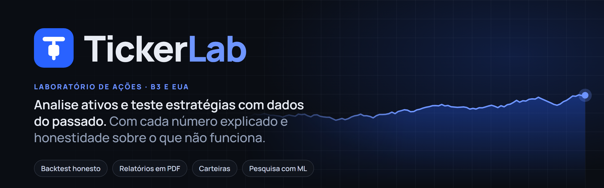
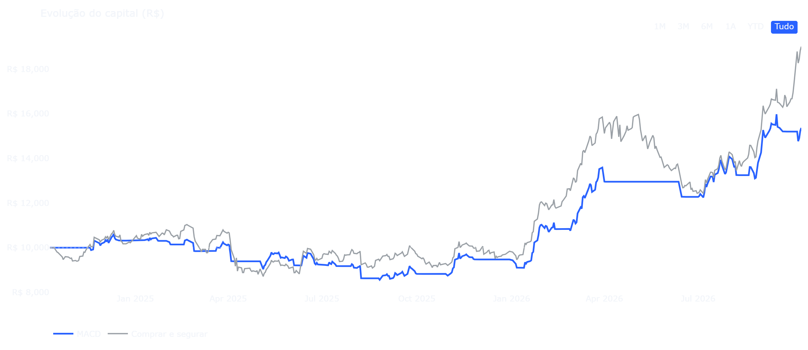
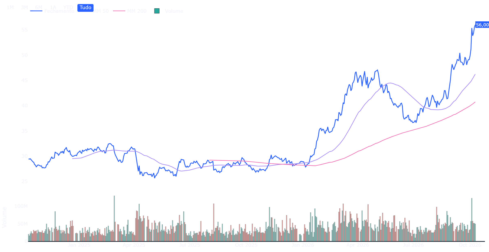
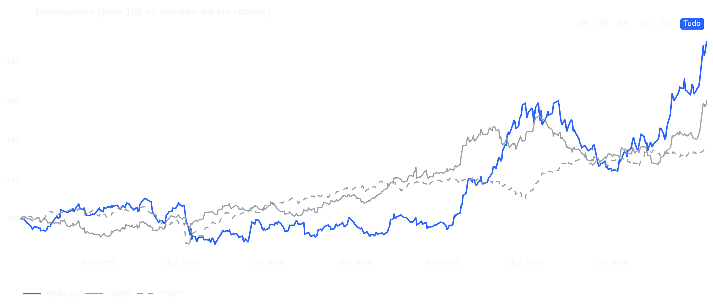
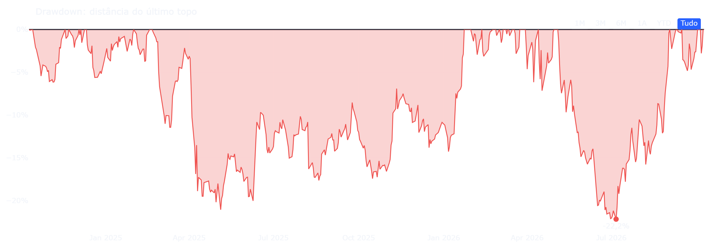
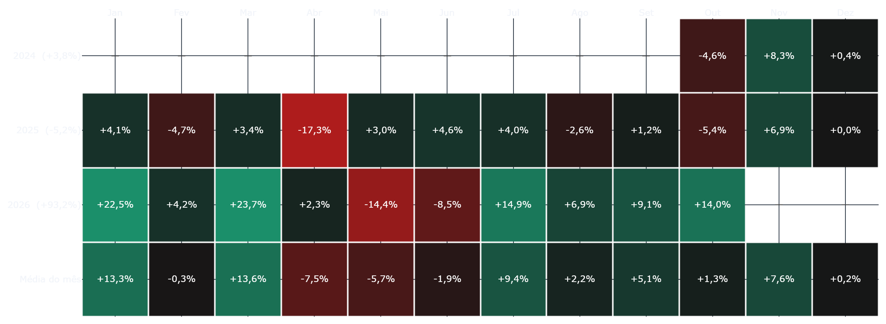

<p align="center">
  
</p>

<p align="center">
  <a href="https://github.com/tbc174/tickerlab/actions/workflows/testes.yml"></a>
  
  
  
  
  
  
</p>

<p align="center">
  <a href="https://tickerlab.com.br"><b>Site</b></a> ·
  <a href="https://app.tickerlab.com.br"><b>Abrir o app</b></a> ·
  <a href="https://tickerlab.com.br/metodologia.html"><b>Metodologia</b></a> ·
  <a href="https://tickerlab.com.br/precos.html"><b>Planos</b></a> ·
  <a href="#tickerlab-trade-a-pesquisa-de-trading-quantitativo"><b>TickerLab Trade</b></a>
</p>

O **TickerLab** é um laboratório educacional de **análise de ações e teste de estratégias com
dados do passado**, para a bolsa brasileira (B3) e a americana. Digite o código de um ativo e o
app busca os dados, analisa com Pandas e testa estratégias num motor de backtest escrito à mão,
sem biblioteca pronta de backtest. Cada número vem explicado em português, e o app mostra também
o que **não** funciona.

> [!IMPORTANT]
> Projeto educacional. Nada aqui é recomendação de investimento. Os dados vêm do Yahoo Finance
> e podem ter atraso ou erros. Rentabilidade passada não garante resultado futuro.

## A história

O TickerLab começou como trabalho da matéria de **Python e Pandas** na faculdade: um script que
baixava o preço de uma ação e desenhava um gráfico. Cada pergunta nova virou uma página ("e se eu
tivesse seguido esta regra?", "isso foi sorte?", "e com vários ativos?"), e o projeto cresceu até
virar um serviço web completo, no ar em [tickerlab.com.br](https://tickerlab.com.br), com contas,
planos, relatórios em PDF e uma pesquisa de trading quantitativo com machine learning.

O código, os textos e as explicações estão em português, e o caminho do aprendizado ficou
registrado no próprio repositório (`notas/`, `guias/`, `estudos/`).
A regra que atravessa tudo: **mostrar os números como eles são**, inclusive quando a resposta é
"não funcionou".

## Em números

| 26 páginas | 12 estratégias | ~1.700 ativos na busca | 3 planos | mais de 1.200 testes automatizados |
|:---:|:---:|:---:|:---:|:---:|
| análise, estratégias, carteiras, relatórios e conta | tendência e reversão, com custos e stops | B3, S&P 500, índices, cripto e câmbio | Gratuito, Plus e Pro | rodam a cada mudança, com PostgreSQL de verdade |

## As partes do projeto

| Parte | O que é | Onde fica |
|---|---|---|
| **App** (`app.tickerlab.com.br`) | o serviço web: análises, estratégias, carteiras, relatórios em PDF, contas e planos | `app.py`, `src/` |
| **Site público** (`tickerlab.com.br`) | páginas estáticas que apresentam o produto, os planos e a metodologia, e levam ao app | `site/`, gerado por `scripts/gerar_site.py` |
| **API** | saúde do serviço e webhook do Stripe | `src/api.py` (FastAPI) |
| **TickerLab Trade** | pesquisa de trading quantitativo com machine learning e MetaTrader 5, em conta de demonstração | `trader/` (roda no PC, fora do app) |
| **Caderno de estudos** | anotações do aprendizado: Python, Pandas, Git, Streamlit, finanças e os erros resolvidos | `notas/`, `guias/`, `estudos/` |

**Tecnologias:** Python 3.12, Pandas, yfinance, Streamlit, Plotly, SQLAlchemy 2, Alembic,
PostgreSQL 16, FastAPI, Stripe (modo de teste), Docker Compose e GitHub Actions. Na pesquisa:
scikit-learn, LightGBM, statsmodels, PyTorch (CPU), numba, joblib e o pacote MetaTrader5.

## O que o app faz

No menu do topo, **Início** e **Gerar relatório** ficam como links diretos, seguidos dos grupos
abaixo. Cada página tem uma frase dizendo para que serve, e cada número tem uma explicação em
português ao passar o mouse no **?**.

| Grupo | Páginas | Pergunta que respondem |
|---|---|---|
| (direto no menu) | Início, Gerar relatório | Por onde começo? Como levo a análise comigo em PDF? |
| Analisar | Visão geral, Risco, Retorno mensal, Comparar ativos, Correlação e beta | Como o ativo se comportou: retorno, volatilidade, quedas, calendário, comparação com Ibovespa e S&P 500, beta |
| Estratégias | Backtest, Ranking de estratégias, Carteira, Experimentos, Fases do mercado | E se eu tivesse seguido uma regra? Qual estratégia foi melhor, descontando a sorte? E com vários ativos? |
| Avançado (Pro) | Aprendizado de máquina, Pairs trading | Um modelo vence a previsão ingênua? Pares de ativos cointegrados |
| Research | Parâmetros, Acontecimentos, Fundamentos | Como eu quero analisar? O que as empresas comunicaram (CVM e SEC)? Como estão os números do balanço? |
| Aprender | Guia e glossário, Termos de uso, Política de privacidade | Como os números são calculados e o que cada termo quer dizer |
| Minha conta | Minhas simulações, Favoritos e momentum, Meus dados e privacidade, Planos e assinatura | O que é meu: simulações guardadas, favoritos, exportar e apagar os dados, plano |
| Mais | TickerLab Trade (Beta) | Em que fase está a pesquisa de trading quantitativo? |
| Administração | Administração | Usuários, planos, assinaturas e registro de ações (só administradores) |



- **Backtest:** 12 estratégias (tendência e reversão), custos, stops, CDI, imposto e validação
  (treino e teste, walk-forward, mapa de parâmetros, Monte Carlo, teste contra o acaso, Sharpe
  deflacionado e PBO). O **Ranking** compara todas descontando a sorte de escolher a melhor
  entre muitas.
- **Carteira:** rotação, momentum dual, inverso da volatilidade, baixa volatilidade, canário e
  paridade hierárquica de risco (HRP).
- **Relatórios em PDF (Report Studio):** relatórios do ativo, de comparação, de backtest e de
  carteira, com prévia real antes de baixar, modelos (Executivo, Completo ou Personalizado),
  escolha e ordem das seções e três estilos visuais. Os números saem das mesmas funções que a tela
  usa, e a seção "Limites e cuidados" é obrigatória. Os relatórios ficam guardados em "Meus
  relatórios".
- **Minha carteira (B3):** envie a planilha de posição baixada na Área do Investidor da B3 para
  analisar a sua carteira e gerar o relatório. O arquivo é lido só na memória: nada é gravado e
  nada vai para os logs.
- **Research:** pesquisa sob medida. Em **Parâmetros** você escolhe janelas, índice de referência
  e temas; **Acontecimentos** reúne fatos relevantes, comunicados e proventos das empresas (CVM no
  Brasil, SEC nos EUA), com o link do documento original e o motivo de cada um aparecer;
  **Fundamentos** calcula margens, ROE, dívida e múltiplos a partir dos balanços entregues à CVM,
  dizendo de onde veio cada número.
- **Busca de ativos:** campo com autocomplete por código ou nome da empresa, a partir de um
  catálogo de cerca de 1.700 ativos (B3, S&P 500, índices, criptomoedas e câmbio). Um código
  digitado nunca é trocado em silêncio.
- **Tutorial por objetivo:** três portas de entrada (analisar uma ação, entender a carteira, gerar
  um relatório), com passos que acontecem em telas de verdade.
- **Outros:** link compartilhável com as escolhas da tela, conversão de ativos em dólar para reais,
  dados de exemplo para usar sem internet.

| Preço e médias móveis | Comparar ativos |
|---|---|
|  |  |
| **Risco (quedas)** | **Retorno mensal** |
|  |  |

### Planos

Os limites ficam num lugar só (`src/planos.py`) e valem também no banco de dados. A cobrança é
**só em modo de teste** do Stripe: nenhum pagamento real é feito.

| | Gratuito | Plus | Pro |
|---|---|---|---|
| Simulações guardadas | 5 | 30 | ilimitadas |
| Favoritos | 3 | 10 | 20 |
| Ativos na carteira | 4 | 6 | 8 |
| Relatórios em PDF | do ativo, 3 por dia | todos os tipos, 20 por dia | todos, sem limite |
| Aprendizado de máquina e Pairs trading | não | não | sim |

### Identidade visual

Tema escuro em degraus de cinza-azulado, azul `#2962FF`, o símbolo "Vela T" (`static/marca/`) e
as fontes Manrope e JetBrains Mono servidas pelo próprio site, sem Google Fonts. As cores ficam
num lugar só, `src/marca.py`, de onde saem o tema do Streamlit, o CSS, o tema dos gráficos e o
site público.

## TickerLab Trade: a pesquisa de trading quantitativo

Uma linha de pesquisa separada do app, para responder com rigor: **um modelo de machine learning,
treinado só com o passado, consegue operar melhor do que uma regra simples de tendência, depois de
custos e descontando a sorte de testar muitas ideias?**

- **Fases:** M0 ambiente (MetaTrader 5 em conta de demonstração) → M1 dados (histórico diário de
  mais de 80 ativos: forex, ações da B3, índices, renda fixa, commodities e cripto) → M2 pesquisa
  com ML → M3 teste em conta demo → M4 controles de risco → M5 painel. Hoje a pesquisa está na M2.
- **Método da M2:** critério de aprovação escrito e aprovado **antes** de ver qualquer resultado
  (Sharpe deflacionado, PBO, t-estatística ≥ 3, vitória sobre a regra de tendência com folga
  estatística, consistência entre ativos e no tempo, estresse de custos, teste contra o acaso);
  validação cruzada combinatória com expurgo (CPCV); custos por classe de ativo e carry de juros;
  testes automáticos de vazamento de informação; registro de **todas** as tentativas; os últimos
  3 anos de dados lacrados como prova final.
- **Resultado até agora:** nenhum modelo foi aprovado (regressão logística, floresta aleatória,
  LightGBM, meta-rotulagem, rede neural MLP e ARIMA). Resultado negativo também é publicado.
- **Regras:** só leitura (há testes que impedem o código de enviar ordens), só conta de
  demonstração, nenhuma ordem com dinheiro real sem decisão escrita do autor, e nada disso roda no
  app público. O pacote `MetaTrader5` só funciona no Windows, por isso a pesquisa roda no PC.

A base do pacote está em `trader/`; o código das fases M1 e M2 fica num ramo separado até a
conclusão da pesquisa.

## Como rodar no seu computador

Requer Python 3.12.

```powershell
python -m venv .venv
.venv\Scripts\python -m pip install -r requirements.txt
.venv\Scripts\python -m streamlit run app.py
```

Sem a configuração do login (`.streamlit/secrets.toml`), o app roda em **modo local**: sem
contas, com todos os recursos liberados e um banco SQLite em `dados_locais/`. Sem internet (ou se
o Yahoo Finance falhar), marque "Usar dados de exemplo" em "Opções avançadas": ele usa cópias de
5 anos de 13 tickers guardadas em `dados_de_exemplo/`.

Site público e pesquisa:

```powershell
.venv\Scripts\python -m scripts.gerar_site                     # gera site/
.venv\Scripts\python -m pip install -r requirements-trader.txt  # só para a pesquisa (Windows)
```

Testes e estilo (mais de mil testes automatizados; a suíte leva alguns minutos):

```powershell
.venv\Scripts\python -m pytest
.venv\Scripts\python -m ruff check .
.venv\Scripts\python -m ruff format --check app.py src tests trader scripts
```

## Configuração (produção)

<details>
<summary>Segredos, variáveis de ambiente e migrações do banco</summary>

Segredos nunca vão para o Git: ficam em arquivos com permissão 600 no servidor.

| Onde | O que |
|---|---|
| `.env` (modelo em `.env.example`) | `TICKERLAB_DATABASE_URL` (PostgreSQL), `TICKERLAB_AMBIENTE=producao` (sem o login configurado, o app não abre), `TICKERLAB_ADMINS`, chaves do Stripe de **teste** (`rk_test_`/`sk_test_`: chaves de produção são recusadas), `STRIPE_PRICE_ID`, `STRIPE_WEBHOOK_SECRET`, `TICKERLAB_URL_PUBLICA` |
| `.streamlit/secrets.toml` (modelo em `secrets.toml.example`) | Cliente OAuth do Google (`[auth]`) |

O esquema do banco é criado pelas migrações do Alembic (`migracoes/`, de 0001 a 0006), aplicadas
sozinhas quando o contêiner sobe: `python -m alembic upgrade head`.

</details>

## Publicar com Docker

<details>
<summary>Os contêineres do app e da API</summary>

O `compose.yaml` sobe dois serviços com a mesma imagem: `tickerlab` (o app, `127.0.0.1:8501`) e
`tickerlab-api` (FastAPI, `127.0.0.1:8000`: `/saude` e o webhook do Stripe). As portas ficam só em
`127.0.0.1`; o acesso de fora vem de um túnel (Cloudflare Tunnel), sem nenhuma porta aberta para a
internet.

```bash
mkdir -p dados_locais && touch .streamlit/secrets.toml   # pasta do cache e arquivo de login
docker compose up -d --build
```

Veja `projeto-acoes/stripe.md` (fora deste repositório, na pasta do projeto) para ligar a
cobrança de teste.

</details>

## Operação

- **Hospedagem:** um VPS em São Paulo com os contêineres Docker e o PostgreSQL, sem nenhuma porta
  aberta para a internet. O tráfego chega pelo Cloudflare Tunnel: `app.tickerlab.com.br` (app),
  `api.tickerlab.com.br` (API e webhook) e `tickerlab.com.br` (site público, servido pelo nginx).
  A administração do servidor é feita só por uma rede privada (Tailscale).
- **Deploy automático:** `scripts/deploy-automatico.sh`, no cron do servidor (a cada 5 minutos),
  puxa a `main` **só se os testes do GitHub Actions passaram** nesse commit, reconstrói os
  contêineres, espera o app e a API ficarem saudáveis e, se não ficarem, volta sozinho para a
  versão anterior. Log em `~/deploy-tickerlab.log`.
- **Logs:** uma linha de JSON por registro (`TICKERLAB_LOG_FORMATO=json`), sem e-mail nem nome:
  `docker logs tickerlab-api | jq`.
- **Monitor:** um Uptime Kuma em outra máquina verifica de fora o app, a API, o site e a rota
  do webhook.
- **Carga leve:** `python scripts/carga_leve.py URL --total 300 --simultaneas 20`.
- **Integração contínua:** o GitHub Actions roda `ruff` e os testes (com PostgreSQL de verdade),
  constrói a imagem e confere que o app, a API e o login do Google abrem dentro dela.

## Segurança e privacidade

- Login só com o Google; e-mail não verificado é recusado. Cada pessoa vê apenas os próprios
  dados (toda consulta filtra pelo usuário, com testes de isolamento).
- Webhook do Stripe com assinatura verificada, idempotente e tolerante a eventos fora de ordem.
  O plano só muda pelo webhook.
- Painel de administração confere o papel **no banco** a cada ação e registra tudo em uma
  auditoria que guarda só ids, nunca e-mail ou nome. Erros do banco não expõem dados pessoais.
- LGPD: aceite dos termos no primeiro acesso (com versão e data), exportação dos dados em JSON e
  exclusão da conta em cascata, encerrando antes a cobrança no Stripe. A planilha da B3 nunca é
  gravada. Os textos estão em `conteudo/termos.md` e `conteudo/privacidade.md` (modelos para um
  projeto educacional, sem revisão de advogado).

## Princípios do projeto

- **Sem olhar o futuro.** Toda decisão tomada no fim do dia só vale a partir do dia seguinte, e
  há testes que conferem que cortar o futuro não muda o passado.
- **Honestidade com os números.** O app mostra o que não funcionou: a maioria das estratégias
  não passa no teste contra o acaso, o Sharpe vem com intervalo e o modelo de aprendizado de
  máquina é comparado com uma previsão ingênua. Na pesquisa, as regras são escritas antes dos
  resultados e resultado negativo também conta.
- **Limites explícitos.** Viés de sobrevivência, custos e imposto simplificados, perna vendida do
  pairs trading sem o custo do aluguel.
- **Cada conceito explicado.** O glossário (`conteudo/glossario.md`) e as explicações de cada
  estratégia (`conteudo/estrategias.md`) aparecem na tela e são conferidos por testes.
- **Sem promessa de rentabilidade.** Em nenhuma tela, relatório ou página do site.

## Estrutura

<details>
<summary>Mapa das pastas e dos módulos</summary>

```
app.py                interface: menu, páginas e telas (só mostra; as contas ficam em src/)
src/
  paginas.py          o mapa do site: grupos, páginas e a frase de cada uma
  planos.py           limites do Gratuito, do Plus e do Pro (um lugar só)
  marca.py            cores e fontes da identidade visual
  autenticacao.py     regras do login com o Google
  banco/              modelo, conexão, usuários e dados por usuário (SQLAlchemy)
  cobranca.py         Stripe: pagamento, portal e eventos (idempotentes)
  api.py              FastAPI: /saude e webhook do Stripe
  administracao.py    painel de administração (permissão conferida no banco)
  conformidade.py     termos, exportar os meus dados e apagar a conta
  auditoria.py        registro de ações sem dados pessoais
  simulacoes.py       salvar e reabrir simulações
  relatorios.py, relatorio_pdf.py, estilos_pdf.py, graficos_pdf.py, previa_pdf.py   relatórios em PDF
  carteira_b3.py      leitura da planilha da Área do Investidor da B3
  catalogo.py         catálogo da busca de ativos
  tutorial.py         tutorial por objetivo e primeiros passos
  trade.py            conteúdo da página TickerLab Trade
  logs.py             logs em texto ou JSON
  dados.py, armazenamento.py, exemplos.py, moedas.py   dados do Yahoo, cache, exemplos e câmbio
  indicadores.py, metricas.py               números básicos e métricas de desempenho
  backtest.py, estrategias.py, protecoes.py motor vetorizado, 12 estratégias e stops
  validacao.py, acaso.py, ranking.py        validação honesta dos resultados
  carteiras.py, hrp.py, experimentos.py, regimes.py, aprendizado.py, pares.py
  graficos.py         gráficos Plotly
trader/               TickerLab Trade: conexão de só leitura com o MetaTrader 5 e dados
site/                 site público estático (gerado)
static/               fontes e símbolo servidos pelo próprio site
conteudo/             glossário, estratégias, catálogo de ativos, termos e privacidade
migracoes/            migrações do banco (Alembic)
scripts/              deploy automático, site público, catálogo, marca, carga leve, imagens do README
tests/                testes automatizados (pytest)
notas/, guias/, estudos/   caderno de estudos do autor
docs/imagens/         figuras deste README (gráficos: scripts/gerar_imagens_do_readme.py; banner: docs/banner.html)
```

</details>

## Referências das técnicas

Sharpe probabilístico e deflacionado (Bailey e López de Prado, 2014), PBO (Bailey, Borwein,
López de Prado e Zhu, 2017), barreira tripla, expurgo e embargo, validação cruzada combinatória,
meta-rotulagem e HRP (López de Prado), variância gerida (Moreira e Muir, 2017), cointegração
(Engle e Granger), limiar de t-estatística para múltiplos testes (Harvey, Liu e Zhu, 2016) e
decaimento de sinais depois de publicados (McLean e Pontiff, 2016). As fórmulas foram
implementadas a partir da descrição dos artigos e conferidas por testes e simulações; vale
conferi-las nas fontes originais antes de qualquer uso sério.

## Direitos autorais

© 2026 Tiago Borsari Coelho. **Todos os direitos reservados.**

Este repositório é público para consulta (avaliação acadêmica e portfólio), mas **não tem licença
de código aberto**: o código, os textos e a identidade visual do TickerLab não podem ser copiados,
modificados, redistribuídos nem usados em outro produto ou serviço sem autorização por escrito do
autor. Ver o código no GitHub e criar um fork pela própria plataforma é permitido pelos termos de
uso do GitHub; isso não dá direito de uso fora dele.

Componentes de terceiros continuam com as próprias licenças: as bibliotecas listadas em
`requirements.txt` e `requirements-trader.txt` e as fontes Manrope e JetBrains Mono (SIL Open
Font License, textos em `static/fontes/`).

---

<p align="center">
  <br>
  Feito por <b>Tiago Borsari Coelho</b> · começou na matéria de Python e Pandas<br>
  <sub>Conteúdo educacional. Sem promessa de rentabilidade.</sub>
</p>
